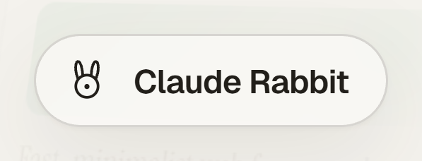
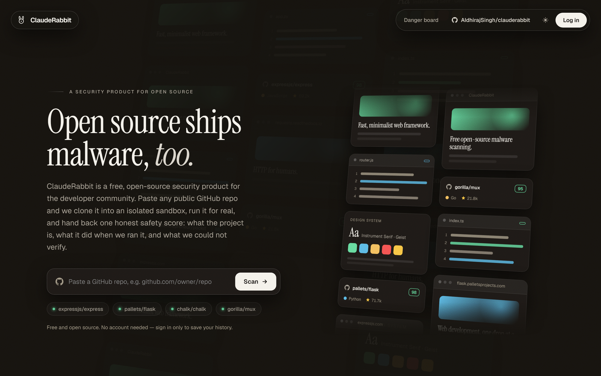
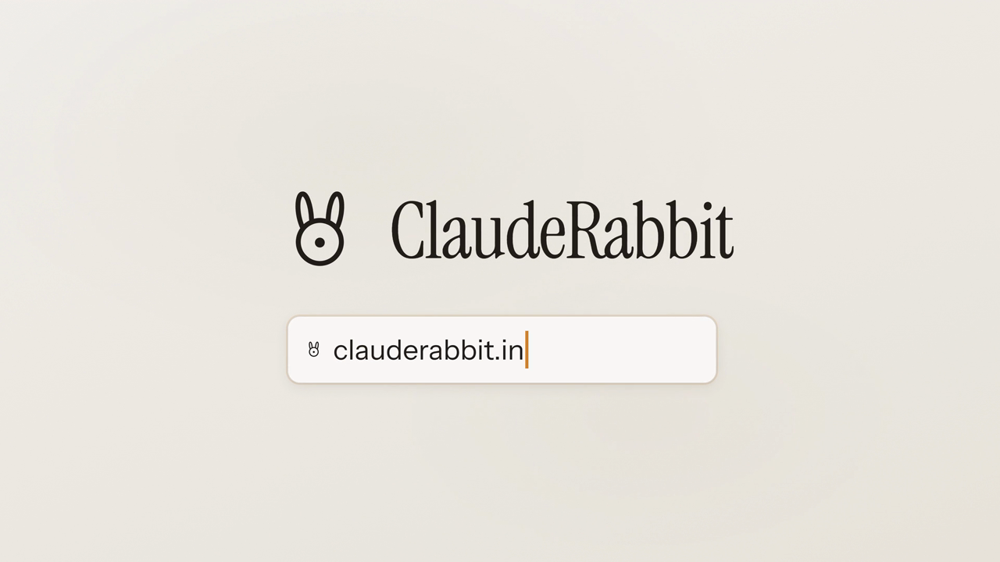

<div align="center">

<picture>
  <source media="(prefers-color-scheme: dark)" srcset="docs/assets/logo-dark-theme.png">
  
</picture>

### Open source ships malware, too.

**Free, open-source malware scanning that doesn't just read a repo. It runs it, in a disposable sandbox, and shows you exactly what it does.**

[](https://www.npmjs.com/package/clauderabbit)
[](LICENSE)
[](https://clauderabbit.in)
[](CONTRIBUTING.md)

[**Scan a repo →**](https://clauderabbit.in) · [CLI](cli/) · [MCP server](mcp-server/) · [How it works](#how-it-works) · [Contributing](CONTRIBUTING.md)

</div>

---

## The problem

More than **454,600 new malicious open-source packages** appeared in 2025, **up 75%** in a single
year, and over 99% of them landed on npm. The attacks that matter carry **no CVE at all**: the
dominant pattern is *install-time execution*, code that runs the moment you `npm install` or clone
and run, harvesting GitHub tokens, cloud credentials, SSH keys, and wallets **before a build even
finishes**. Self-replicating worms (Shai-Hulud and its 2026 descendants) republish themselves
through every developer they touch. A favorite delivery method is a fake recruiter's "take-home"
repo. Every tool that waits for a disclosed vulnerability is, by construction, looking the wrong way.

And the honest developer's side of it: you clone something, run it, and *then* wonder if you should
have. Trust ends up decided on a vibe, stars, a clean README, a gut feeling.

## Nobody built the obvious tool for that

The behavior that defines modern open-source malware is invisible to anything that only *reads*
source and guesses at intent, static scanners, package-reputation tools, the existing free
repo-checkers are all structurally blind to it. So **ClaudeRabbit doesn't guess. It runs the code.**

Paste any public GitHub repo (or an npm package, scanned as its real published tarball, the exact
bytes `npm install` fetches, not the repo it merely links to, so a malicious install hook injected
only into the published artifact is caught) at **[clauderabbit.in](https://clauderabbit.in)** -
no account needed. Every scan installs and runs the code in a **real, disposable sandbox**, with a
target of about eight seconds on a small package. If it tries to phone home or steal a credential,
ClaudeRabbit doesn't just block it: a forge inside the sandbox **answers with a fake-success
response**, so the malware thinks it got away with it, and that is the exact moment it's caught. You
get back one **0-100 safety score**: what the project is, what it did when we ran it, and always
**what we could not verify**. Never a blind "Safe" with nothing behind it. Every report is public
and permanent at `/owner/repo` (or `/npm/<package>` for a registry package), shareable, and
embeddable as a trust badge. Each result carries one clearly labelled sponsored message; ads never
gate a scan or a result.

<div align="center">
  <a href="https://clauderabbit.in"></a>
</div>

## Demo

The 85-second launch film, the threat, the sandbox, and the moment a repo gets caught phoning home.
Click to play, or watch the product live at **[clauderabbit.in](https://clauderabbit.in)**.

<div align="center">
  <a href="docs/assets/demo.mp4"></a>
</div>

> A vertical cut of the same film ships for Reels/Shorts. Direct file: [`docs/assets/demo.mp4`](docs/assets/demo.mp4).

## Quickstart

**On the web**, go to **[clauderabbit.in](https://clauderabbit.in)**, paste a GitHub URL (or
`owner/repo`), hit scan. No login required; signing in only saves your scan history.

**From the terminal**, the [CLI](cli/) ([`clauderabbit`](https://www.npmjs.com/package/clauderabbit)
on npm) scans a repo or npm package before you install or clone it:

```bash
npm install -g clauderabbit                          # one-time setup
clauderabbit scan expressjs/express                  # run a real scan
```

**From an AI coding agent**, the [MCP server](mcp-server/) exposes one cache-aware `scan` tool over
stdio so an agent can check a dependency before it ever clones it (also served remotely over
Streamable HTTP at `clauderabbit.in/mcp` for claude.ai custom connectors). Wire it into Claude
Desktop with `clauderabbit mcp install` (installed as part of the CLI above).

Both the CLI and the MCP server call the same public scan API the website uses and need no
account: install and scan. Anonymous fresh scans are rate limited (at most 6 running at once and 6 starting per minute across
the service; per client IP, 10 fresh scans per hour and 30 per day); stored reports always come back
at once and never count. See [cli/README.md](cli/README.md) and
[mcp-server/README.md](mcp-server/README.md) for the full command/tool reference, or
**[docs/GETTING-STARTED.md](docs/GETTING-STARTED.md)** for a full beginner's walkthrough (install →
scan → wire up the MCP server → connect claude.ai Custom Connectors → update).

## How it works

```
paste URL -> POST /api/scan (one Vercel function) -> cache check (commit SHA or npm version+integrity)
   hit  -> stored report + replay of its recorded event stream
   miss -> fetch the GitHub or npm tarball into memory, verify it
           -> in parallel:
              (a) static: Semgrep, YARA, GuardDog (offline E2B analysis sandbox), OSV malicious-package
                  lookup on every dependency, in-process heuristics
              (b) reachability graph of code that runs at install or import
              (c) model readers (structured output) on that slice: install surface, flagged code,
                  README versus code
              (d) detonation in a fresh E2B sandbox: a root forge answers every outbound call; the
                  repo installs with every dependency and script (npm scripts on, uv for Python) and
                  runs its entry point as a non-root user on a fast fake clock; forensics recorded;
                  the sandbox is destroyed
           -> deterministic score in code (behaviour outweighs static; unreachable code never lowers it)
           -> the model writes the report -> persist + public /owner/repo
   every stage, timing, forged call, file, process and check streams to the client and to
   Supabase Realtime, and is stored per SHA for replay
```

Two safety rails, always: **(1)** no surface ever states a bare "Safe": every verdict shows its
evidence and what was *not* verified; **(2)** the sandbox holds no real credentials, every outbound
call is answered by our forge, resources are capped, and a fresh VM is used for every scan and
destroyed after it. Reputation signals (owner history, account age, stars) and code/behaviour
signals (what the code does, what running it revealed) are always kept visibly separate.

## Stack

| Layer | Choice |
|---|---|
| Web and scan | **Next.js 16 (App Router) on Vercel**: homepage SPA, SSR `/owner/repo` SEO pages, and `POST /api/scan`, which runs the whole engine (`lib/engine/`) |
| DB / Auth / Realtime | **Supabase** (Postgres + RLS, Google + email auth, Realtime broadcast of scan events) |
| Sandbox | **E2B**: one fresh VM per scan from a pinned template (`sandbox/e2b/`) |
| Model | **OpenAI `gpt-6-luna`** through one adapter (`lib/engine/model/`); model id in config (`CR_MODEL_ID`) |
| Scoring | Deterministic formula in code (`lib/engine/score.ts`); the model supplies evidence and prose, code decides the number |
| Design | Faithful port of the shipped Claude Design spec (`design.md`) |

## Local development

```bash
npm install
cp .env.example .env.local   # fill in the Supabase URL + publishable key (public values)
npm run dev                  # http://localhost:2311
```

`npm run lint`, `npm run typecheck`, `npm test` (engine, a keyless end-to-end scan with a test-only
stand-in model and mock sandbox, and the PGlite migration round trip), `npm run test:python` (forge)
and `npm run build`. A CI workflow with the same gates plus gitleaks ships in
`.github/workflows/ci.yml.disabled` (rename to `ci.yml` to enable).

## Secrets (server-side only, never in the client or the repo)

The client holds **only** public values: `NEXT_PUBLIC_SUPABASE_URL`,
`NEXT_PUBLIC_SUPABASE_PUBLISHABLE_KEY`, `NEXT_PUBLIC_SITE_URL` and the optional AdSense IDs. Every
credential is a Vercel server environment variable: `OPENAI_API_KEY`, `E2B_API_KEY`,
`CR_V2_DATABASE_URL` (the least-privilege `cr_v2_server` login, schema `v2` only), and the optional
`GITHUB_TOKEN` and `CR_OPERATOR_KEY`. Full table:
`docs/INFRASTRUCTURE.md` section 6.

## Deploy to Vercel

1. Import the repo into Vercel (framework auto-detected: Next.js).
2. Set the env vars from `.env.example` in the Vercel project.
3. Build the E2B template once (`E2B_API_KEY=... npm run template:build`) and set `CR_E2B_TEMPLATE`.
4. Apply `supabase/migrations/` to the database (non-production first, `scripts/db-branch-apply.mjs`).
5. Deploy. The key-day checklist is in `docs/runs/2.0-backend.md`.

## Repo layout

```
app/                     Next.js routes (SPA home, /[owner]/[repo] + /npm/<pkg> SSR reports, /badge, /mcp,
                         /api/scan, /api/runs/<id>/events, /oauth/token)
components/spa/          the faithful design port (7 screens + shared chrome + state machine)
lib/engine/              the 2.0 scan engine: resolve, archive, reachability, static, OSV, model,
                         sandbox orchestration, forensics, score, ads, events, store
lib/                     report view, types, supabase clients, scan client
sandbox/e2b/             the E2B template, its build script, the in-VM harness and the forge (the moat)
supabase/migrations/     schema + RLS (reverse files in supabase/migrations-down/)
tests/                   engine tests, keyless e2e, fixtures (our own phone-home fixture), labeled set
cli/                     the clauderabbit CLI (scan, mcp install)
mcp-server/              MCP server (one cache-aware scan tool over stdio for AI coding tools)
docs/                    north star, UX, INFRASTRUCTURE, COST, 2.0 design, run records
design.md                the shipped Claude Design spec (source of truth for the UI + reports)
```

## Contributing & community

ClaudeRabbit is a public good, and contributions are welcome, see
**[CONTRIBUTING.md](CONTRIBUTING.md)** for how to run it locally and open a PR, and our
**[Code of Conduct](CODE_OF_CONDUCT.md)**. Good starting points are labelled
[`good first issue`](https://github.com/AIdhirajSingh/clauderabbit/issues?q=is%3Aissue+is%3Aopen+label%3A%22good+first+issue%22).
Questions, ideas, and "is this repo safe?" discussions belong in
[GitHub Discussions](https://github.com/AIdhirajSingh/clauderabbit/discussions).

## License

[MIT](LICENSE) © 2026 Adhiraj Singh.

---

<div align="center">

Free and unlimited, no login or ads ever required to scan. The accumulating database of vetted repos
is the real asset, see [`docs/INFRASTRUCTURE.md`](docs/INFRASTRUCTURE.md) for the honest current
state of the (still-open) monetization question.

</div>
